<div align="center">



<br>

[](https://github.com/Erick-Cantagallo/HECE/actions/workflows/ci.yml)

-111827?logo=ollama&logoColor=white)


**Transforma uma pergunta científica em uma investigação estruturada:<br>literatura real do arXiv, agentes de IA que criticam uns aos outros<br>e uma nota de viabilidade calculada por matemática, não por palpite.**

[Como funciona](#-como-funciona) ·
[A nota](#-a-nota-não-vem-da-ia) ·
[Começando](#-começando-em-3-minutos) ·
[Testes](#-testes) ·
[Roadmap](#-roadmap) ·
[English](#-english-summary)

</div>

---

## 💡 Por que o HECE existe

Modelos de linguagem falam com muita confiança, inclusive quando estão errados. O HECE aposta no oposto: **honestidade científica antes de resposta convincente**. Em vez de simplesmente *responder*, ele *investiga*:

1. **entende** o objetivo, detecta o domínio e extrai as restrições;
2. **busca literatura real** no arXiv e injeta as leis do domínio como regras que não podem ser violadas;
3. coloca **três agentes** (Expert, Critic e Synthesizer) para propor, atacar e consolidar hipóteses;
4. **calcula a viabilidade em Python puro**: a IA aponta os problemas, mas nunca atribui a nota;
5. entrega tudo em um **paper em PDF**, com premissas, falhas e limitações à vista.

> Às vezes a resposta correta é *"a ciência atual ainda não consegue responder isso"*. Essa é a filosofia do projeto (veja [`docs/PROJECT_IDENTITY.md`](docs/PROJECT_IDENTITY.md)).

| ✅ O HECE é | ❌ O HECE não é |
| --- | --- |
| Uma plataforma de investigação científica estruturada | Um chatbot |
| Transparente: premissas, falhas e incertezas ficam expostas | Um oráculo que sempre tem uma resposta |
| Modular: cada motor de raciocínio é substituível | Um substituto para cientistas e pesquisadores |

---

## 🔬 Como funciona

```mermaid
flowchart LR
    G(["🎯 Objetivo<br/>(texto livre)"]) --> I["<b>GoalInterpreter</b><br/>domínio · palavras-chave<br/>restrições · complexidade"]
    I --> K["<b>KnowledgeEngine</b><br/>axiomas do domínio<br/>+ RAG no arXiv"]
    K --> C["<b>ConstraintEngine</b><br/>regras duras vs.<br/>preferências"]
    C --> A

    subgraph A["🤖 Investigação multiagente · LLM local (Ollama)"]
        direction LR
        E["<b>Expert</b><br/>propõe"] --> R["<b>Critic</b><br/>ataca"] --> S["<b>Synthesizer</b><br/>JSON + auto-retry"]
    end

    A --> M["<b>SimulationEngine</b><br/>nota determinística<br/>(Python puro, sem IA)"]
    M --> P(["📄 Paper em PDF<br/>+ conclusão"])

    classDef ai fill:#1e1b4b,stroke:#a78bfa,color:#ede9fe;
    classDef det fill:#0c4a6e,stroke:#67e8f9,color:#e0f2fe;
    class E,R,S ai;
    class I,K,C,M det;
    style A fill:#0f172a,stroke:#a78bfa,stroke-dasharray: 5 5,color:#e2e8f0
    linkStyle 4,5 stroke:#a78bfa,stroke-width:2px
```



<sub>🟦 etapas determinísticas · 🟪 etapas com LLM</sub>

| # | Etapa | Módulo | O que faz |
| :-: | --- | --- | --- |
| 1 | **Interpretar** | [`interpreter.py`](src/hece/interpreter.py) | Extrai palavras-chave, detecta o domínio (física, biologia, química, ciência da computação), estima a complexidade (1 a 10) e identifica restrições como *without* e *only*. Sem LLM. |
| 2 | **Conhecer** | [`knowledge.py`](src/hece/knowledge.py) · [`tools.py`](src/hece/tools.py) | Injeta os axiomas do domínio (hoje: física e biologia) e busca artigos reais no arXiv a partir das palavras-chave do objetivo (RAG). |
| 3 | **Restringir** | [`constraints.py`](src/hece/constraints.py) | Separa regras **duras** (leis do domínio e restrições estritas) de **preferências** e define os critérios de avaliação. |
| 4 | **Investigar** | [`agents.py`](src/hece/agents.py) | O **Expert** propõe, o **Critic** ataca, o **Synthesizer** devolve JSON estruturado, com auto-correção (retry) e um filtro contra respostas vazias do tipo *"None"*. |
| 5 | **Pontuar** | [`simulation.py`](src/hece/simulation.py) | Calcula a nota de viabilidade e o status de cada hipótese. Matemática pura. |
| 6 | **Publicar** | [`paper.py`](src/hece/paper.py) | Compila literatura, método, hipóteses e a conclusão em um PDF dentro de `reports/`. |

### Como é uma execução

> Exemplo ilustrativo: as linhas de domínio e complexidade vêm do interpretador real; o texto das hipóteses (e, portanto, as notas) varia conforme o modelo usado.

```text
$ hece "Can quantum sensors detect dark matter?" -p Orion -n 2

🧠 HECE ENGINE INITIALIZED - PROJECT: ORION
--------------------------------------------------
🔍 Status: Interpreting user goal...

[+] Domain Detected: PHYSICS
[+] Complexity Level: 5/10

📚 Status: Retrieving Scientific Context & Literature...
    -> [RAG] Searching ArXiv database for real-world context...

🚧 Status: Establishing Scientific Boundaries...

🤖 Status: Activating Multi-Agent Investigation (Target: 2 Hypotheses)...
   [Iteration 1]
    -> [Expert] Proposing novel hypothesis...
    -> [Critic] Searching for constraint violations...
    -> [Synthesizer] Merging critique and extracting citations...
   [Iteration 2]
    ...

[+] EVALUATION RESULTS:
    🟢 Hypothesis 1 -> [ACTIVE] (Feasibility: 75%)
    🔴 Hypothesis 2 -> [REJECTED] (Feasibility: 35%)

[+] SUCCESS! Paper published at: reports/HECE_Orion_<data>.pdf
```

---

## 🧮 A nota não vem da IA

LLMs erram contas e costumam ser generosos consigo mesmos. Por isso, no HECE a IA só **aponta** violações, falhas lógicas e premissas; quem **pontua** é o [`SimulationEngine`](src/hece/simulation.py), com uma fórmula fixa e auditável:

```text
nota = 1,00 − 0,40 × violações de restrições duras
            − 0,15 × falhas lógicas
            − 0,05 × premissas não comprovadas        (limitada a 0 – 1)
```

**🟢 ≥ 0,70 `active`** · **🟡 ≥ 0,40 `speculative`** · **🔴 < 0,40 `rejected`**

| Hipótese | Violações duras | Falhas lógicas | Premissas | Nota | Status |
| --- | :-: | :-: | :-: | :-: | --- |
| A | 0 | 0 | 2 | **0,90** | 🟢 active |
| B | 0 | 1 | 2 | **0,75** | 🟢 active |
| C | 1 | 0 | 2 | **0,50** | 🟡 speculative |
| D | 1 | 1 | 2 | **0,35** | 🔴 rejected |
| E | 2 | 1 | 3 | **0,00** | 🔴 rejected |

<sub>Valores gerados pelo próprio `SimulationEngine`.</sub>

---

## 🚀 Começando em 3 minutos

**Pré-requisitos:** Python 3.10+ e o [Ollama](https://ollama.com/download) instalado e rodando.

```bash
# 1) baixe um modelo local
ollama pull llama3

# 2) instale o HECE
git clone https://github.com/Erick-Cantagallo/HECE.git
cd hece
python -m venv .venv && source .venv/bin/activate     # Windows: .venv\Scripts\activate
pip install -e .

# 3) investigue!
hece "Can quantum sensors detect dark matter?" -p Orion -n 2
```

- Sem argumentos, `hece` abre o **modo interativo** (pergunta o nome do projeto, o objetivo e quantas hipóteses gerar). `python -m hece` faz o mesmo.
- O relatório sai em `reports/HECE_<projeto>_<data>.pdf`.
- Escreva o objetivo **em inglês**: o interpretador determinístico reconhece palavras-chave nesse idioma.
- Mais hipóteses significam mais chamadas ao modelo (Expert, Critic e Synthesizer, por hipótese) e, portanto, mais tempo.
- Quer as versões exatas testadas pelo autor? `pip install -r requirements.txt && pip install -e . --no-deps`.

### ⚙️ Configuração

Copie [`.env.example`](.env.example) para `.env` (opcional; os valores abaixo já são os padrões):

| Variável | Padrão | Para que serve |
| --- | --- | --- |
| `MODEL_NAME` | `llama3` | Modelo do Ollama usado por todos os agentes (`ollama pull <modelo>` antes) |
| `MAX_RETRIES` | `3` | Quantas vezes o Synthesizer tenta de novo quando o LLM devolve um JSON inválido |

Se o Ollama estiver fora do ar ou o modelo não tiver sido baixado, o HECE para na hora com uma mensagem que diz como resolver, em vez de seguir adiante com um erro disfarçado de resposta.

---

## 🧪 Testes

```bash
pip install -e ".[dev]"
pytest
```

A suíte roda em segundos e **não precisa de Ollama, internet nem GPU**: o LLM e o arXiv são simulados. Cada push e cada pull request passam pelo [CI](.github/workflows/ci.yml) em Python 3.10, 3.11, 3.12 e 3.13, e também com as versões fixadas em `requirements.txt`. O Dependabot mantém as dependências em dia.

---

## 🗂️ Estrutura do projeto

```text
hece/
├── src/hece/
│   ├── main.py            # CLI (`hece`) e orquestração do pipeline
│   ├── interpreter.py     # GoalInterpreter (determinístico)
│   ├── knowledge.py       # axiomas do domínio + RAG
│   ├── tools.py           # busca no arXiv
│   ├── constraints.py     # regras duras × preferências
│   ├── agents.py          # Expert · Critic · Synthesizer (+ auto-retry)
│   ├── inference.py       # cliente do Ollama
│   ├── simulation.py      # nota determinística
│   ├── paper.py           # gerador do PDF
│   ├── report.py          # exportação em Markdown (fora do fluxo principal)
│   ├── hypothesis.py      # motor de hipóteses original (legado)
│   └── core/models/       # modelos Pydantic v2
├── tests/unit/            # testes unitários (sem rede, sem LLM)
├── docs/                  # visão, constituição, glossário e especificações
└── .github/               # CI e Dependabot
```

---

## 🧭 Roadmap

- [x] **Sprint 1:** Goal Interpreter
- [x] **Sprints 3 a 5:** motores de conhecimento, restrições, hipóteses e simulação
- [x] **Sprint 7:** orquestração multiagente (Expert, Critic e Synthesizer)
- [x] **Sprint 8:** integração externa com RAG no arXiv
- [x] **Sprint 9:** múltiplas hipóteses e geração do paper em PDF
- [x] **Sprint 10:** matemática determinística e credibilidade
- [ ] **Sprint 11:** interface de uso (web com Streamlit ou CLI rico no terminal)

Mais detalhes em [`ROADMAP.md`](ROADMAP.md) e no [`CHANGELOG.md`](CHANGELOG.md).

---

## ⚠️ Limitações (honestidade científica)

- A qualidade das hipóteses depende do modelo local: modelos pequenos erram o formato JSON ou ignoram críticas (é por isso que existe o auto-retry).
- A nota é determinística, mas as violações, falhas e premissas contadas vêm do Critic e do Synthesizer, ou seja, de um LLM.
- Só há axiomas de domínio para **física** e **biologia**; os demais domínios usam as regras gerais do método científico.
- O PDF usa as fontes padrão (Latin-1): caracteres fora desse conjunto aparecem como `?`.
- O resultado é um **ponto de partida para revisão humana**, não uma conclusão científica.
- A inferência é local; a única chamada à internet é a busca no arXiv.

---

## 🤝 Contribuindo e citando

Contribuições são bem-vindas: leia o [`CONTRIBUTING.md`](CONTRIBUTING.md) e o [`CODE_OF_CONDUCT.md`](CODE_OF_CONDUCT.md). Para citar o projeto, use o botão **"Cite this repository"** do GitHub (arquivo [`CITATION.cff`](CITATION.cff)). Licença [MIT](LICENSE).

---

## 🇬🇧 English summary

**HECE (Hypothesis & Creativity Engine)** turns a scientific question into a structured investigation. It interprets the goal, retrieves real literature from arXiv, injects domain laws as hard constraints, lets three local-LLM agents (Expert, Critic, Synthesizer) propose, attack and consolidate hypotheses, then scores each one with a **deterministic Python formula** (the AI never assigns the score) and publishes everything as a PDF paper.

```bash
ollama pull llama3
pip install -e .
hece "Can quantum sensors detect dark matter?" -p Orion -n 2
```

`score = 1.00 − 0.40 × violated hard constraints − 0.15 × logical flaws − 0.05 × unproven assumptions` (clamped to 0–1): `≥ 0.70` active, `≥ 0.40` speculative, otherwise rejected. Inference runs locally through Ollama; the only network call is the arXiv search. Requires Python 3.10+.

<div align="center">
<sub>Feito com curiosidade e metodologia · <i>“Curiosity deserves methodology.”</i></sub>
</div>
