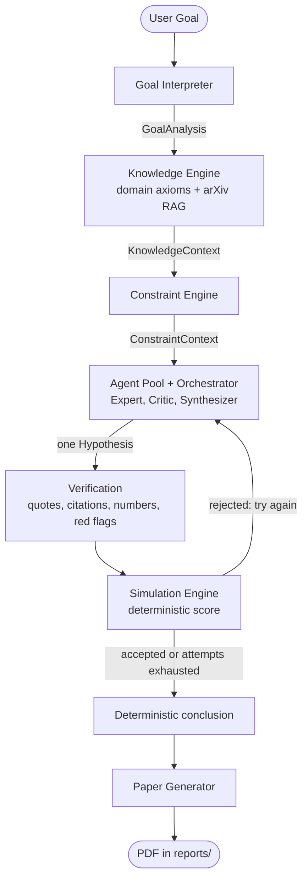
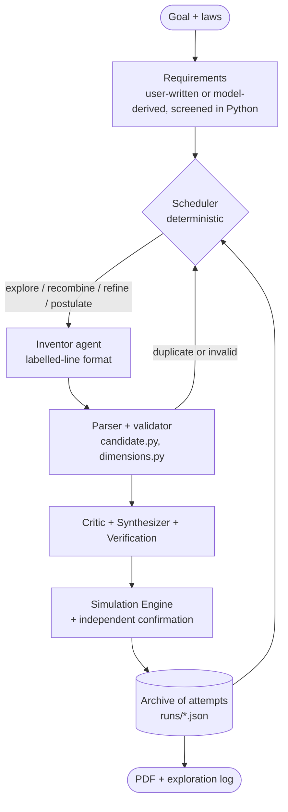

# Current Architecture

> 🚧 HECE is under construction. This page describes version 1.0, not the final design.

HECE has two modes that share the same building blocks:

- **Classic investigation** (`hece`, `run_hece()` in `src/hece/main.py`): generates a requested number of hypotheses and keeps only the ones that survive the automated screening.
- **Inventor mode** (`hece-discover`, `run_discovery()` in `src/hece/pipeline.py`): explores many different mechanisms for one goal, remembers what failed and why, and can postulate new physical quantities. See the [discovery engine](DISCOVERY_ENGINE.md) page.

The language model only **proposes and comments**. Everything that decides a score (whether an accusation is real, whether a citation exists, whether the numbers add up) is checked in Python.

## Classic investigation

`run_hece()` runs a rejection-sampling loop: one candidate per attempt, up to 4 attempts per requested hypothesis. A candidate is kept only with no verified law violation and a score of at least 65%. If none passes, the report shows the best 3 near misses, marked REJECTED, with the reason for each.

| Stage | Module | Produces |
| --- | --- | --- |
| Goal Interpreter | `interpreter.py` | `GoalAnalysis` (keywords, domain, complexity, constraints), no LLM |
| Knowledge Engine | `knowledge.py`, `tools.py` | `KnowledgeContext` (domain laws, arXiv literature with a local cache, limitations) |
| Constraint Engine | `constraints.py` | `ConstraintContext` (hard constraints, soft constraints, criteria) |
| Agent Pool + Orchestrator | `agents.py`, `inference.py` | `Hypothesis`: Expert proposes, Critic checks laws and internal flaws, Synthesizer extracts JSON (auto-retry, `MAX_RETRIES`) |
| Verification | `verification.py`, `redflags.py`, `numerics.py`, `lawchecks.py` | only accusations with a real quote count; invented citations are dropped; known pseudo-science patterns and wrong unit conversions are flagged; efficiencies above the Carnot limit are verified violations; law-level red flags block acceptance |
| Simulation Engine | `simulation.py` | feasibility score and status (formula printed in every PDF) |
| Conclusion | `conclusion.py` | plain-text summary built without any LLM call, so it cannot endorse anything |
| Paper Generator | `paper.py` | PDF report |

## Inventor mode

| Piece | Module |
| --- | --- |
| Exploration loop and archive | `explorer.py` |
| Candidate format and validation | `candidate.py` |
| SI dimensional analysis for postulated quantities | `dimensions.py` |
| Concept bank for recombination | `concepts.py` |
| Entry point shared by the CLI and the app | `pipeline.py`, `discover.py` |

## Measuring the screening

`hece-benchmark` scores fixed hypotheses whose verdict is known (`benchmarks/screening.json`) and reports how many sound ones were accepted and how many law-breaking ones slipped through. Run it after any change to the scoring, the prompts or the red flags.

## Interfaces

- `hece` / `python -m hece`: classic investigation, interactive or one-shot.
- `hece-discover` / `python -m hece.discover`: inventor mode.
- `hece-benchmark`: screening benchmark.
- `streamlit run app.py`: web interface for both modes (`pip install -e ".[app]"`).

## Local inference and failures

Inference goes through Ollama (`inference.py`). A server error while the model loads is retried once. When Ollama is unreachable or the model is missing, `InferenceEngine.ask` raises `InferenceError` with a message explaining how to fix it: the classic CLI exits with status 1, inventor mode stops and keeps the attempts made so far, and the web app shows the message.

Not part of the main flow: `hypothesis.py` (the original single-shot `HypothesisEngine`) and `report.py` (Markdown export).
