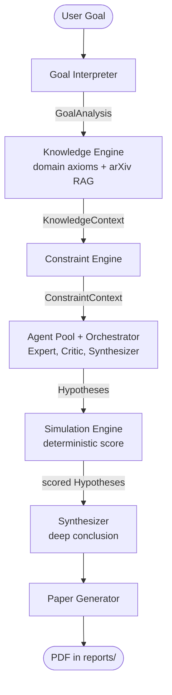

# Current Architecture

> 🚧 HECE is under construction. This page describes the current prototype, not the final design.

HECE is a linear investigation pipeline orchestrated by `run_hece()` in `src/hece/main.py`.
Deterministic stages never call an LLM; only the multi-agent stage (and the final conclusion) do.

| Stage | Module | Produces |
| --- | --- | --- |
| Goal Interpreter | `interpreter.py` | `GoalAnalysis` (keywords, domain, complexity, constraints) |
| Knowledge Engine | `knowledge.py`, `tools.py` | `KnowledgeContext` (domain laws, arXiv literature, limitations) |
| Constraint Engine | `constraints.py` | `ConstraintContext` (hard constraints, soft constraints, criteria) |
| Agent Pool + Orchestrator | `agents.py`, `inference.py` | `Hypothesis` objects, with JSON auto-retry (`MAX_RETRIES`) |
| Simulation Engine | `simulation.py` | feasibility score and status for every `Hypothesis` |
| Paper Generator | `paper.py` | PDF report |

Local inference goes through Ollama (`inference.py`). When Ollama is unreachable or the model is
missing, `InferenceEngine.ask` raises `InferenceError` with a message explaining how to fix it, and the
CLI exits with status 1.

Not part of the main flow: `hypothesis.py` (the original single-shot `HypothesisEngine`) and
`report.py` (Markdown export).
